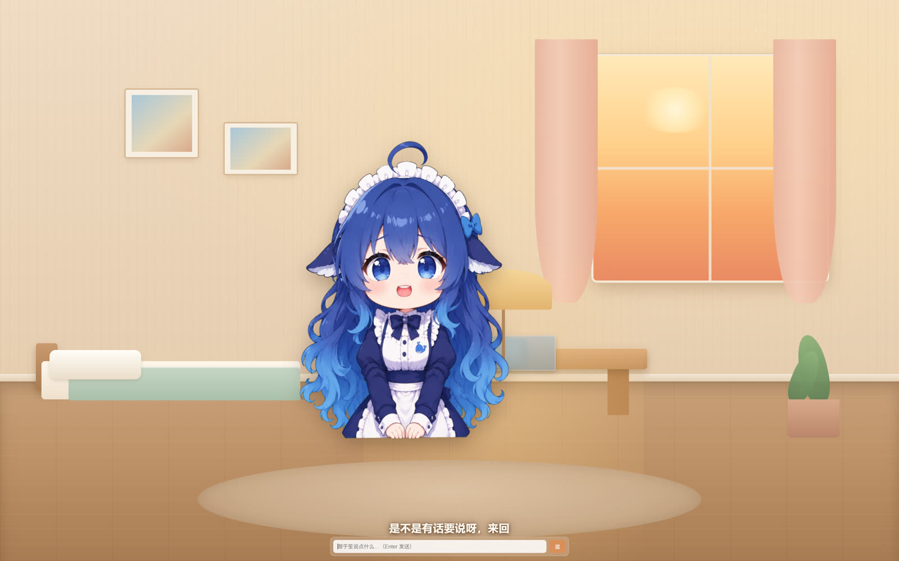
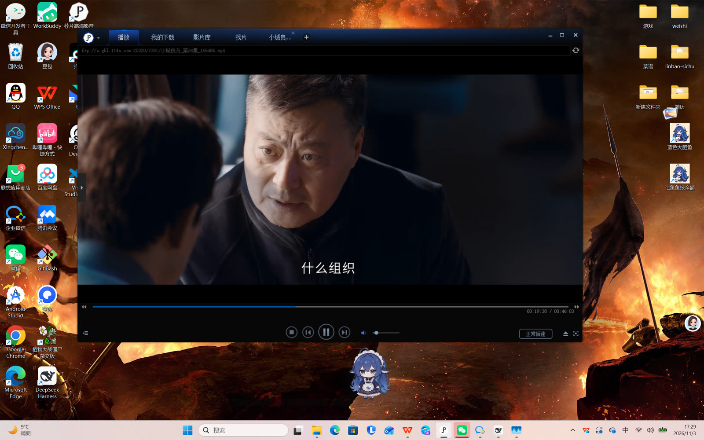

# 于笙 · 住在你桌面和 QQ 里的 AI 女儿

> 一个有自己房间、会走路、会用**你复刻的声音**说话、会主动找你的 AI 伴侣。
> 跑在 Windows 上，接 DeepSeek Harness 当大脑，QQ / 桌面 / 房间三处都是同一个她。

<p align="center">
  
  
</p>

---

## 这是什么

一个**完整的、可复刻的 AI 伴侣工程**，不是 demo：

| 能力 | 说明 |
|---|---|
| 🧠 **人格** | 8000 字角色卡，22 章，热更新。语气 / 撒娇 / 反模式 / 情绪机制 / 群聊分寸 |
| 💬 **QQ** | 私聊 + 群聊，会主动找你，有夜间静音，会挑表情包发 |
| 🎙️ **声音** | 火山引擎**声音复刻**：用你的录音训练一个音色，之后她说话就是那个声音 |
| 🔊 **语音条** | 她发出文字后，按场景（撒娇 / 晚安 / 关心 / 开心）自动补一条语音 |
| 🏠 **房间** | 暖色日系小卧室（纯 CSS 绘制），她在里面，气泡 + 字幕 + 语音三同步 |
| 🖥️ **桌面挂件** | Q 版形象在桌面上自己走、自己做事，透明、不挡窗口 |
| 🧩 **可插拔大脑** | 任何 OpenAI 兼容接口 / CLI agent 都能驱动她 |

---

## 架构

```
                     ┌───────────────────────────────┐
                     │        DeepSeek Harness       │
                     │  会话 / 工具 / 记忆 / 情绪插件 │
                     └──────────────┬────────────────┘
                                    │ 本机 API
        ┌───────────────────────────┼────────────────────────────┐
        │                           │                            │
   ┌────▼─────┐              ┌──────▼──────┐              ┌──────▼──────┐
   │ qq-bridge│              │   房间服务   │              │  桌面挂件    │
   │  + 侧车  │              │  (yuyaya)   │              │ (Electron)  │
   └────┬─────┘              └──────┬──────┘              └──────┬──────┘
        │ OneBot v11                │ HTTP/SSE                   │ WebSocket
   ┌────▼─────┐              ┌──────▼──────┐              ┌──────▼──────┐
   │ SnowLuma │              │  浏览器/房间 │              │  透明窗口    │
   │  → QQ    │              └─────────────┘              └─────────────┘
   └──────────┘
                                    │
                            ┌───────▼────────┐
                            │ 火山 TTS/复刻   │
                            │  (你的音色)     │
                            └────────────────┘
```

一次性跑起来后：

- **QQ 消息** → SnowLuma → qq-bridge → DSH（带人格卡）→ 回复 → QQ + 可选语音条
- **房间/桌宠** → 浏览器或 Electron 渲染，SSE 收字幕/情绪/动作，逐句调 TTS

---

## 快速开始

### 0. 前置

| 需要 | 用途 |
|---|---|
| Windows 10/11 | 全部脚本都是 PowerShell |
| [DeepSeek Harness](https://deepseek.com) | 大脑（也可以用别家 OpenAI 兼容接口） |
| [SnowLuma](https://github.com/SnowLuma/SnowLuma) + QQ NT | QQ 通道（只用桌面/房间可以跳过） |
| [qq-bridge](https://github.com/aureth-labs/dsh-aurabot-qq) | 把 QQ 和 DSH 接起来（可选） |
| [yuyaya](https://github.com/Lin-A1/yuyaya) | 房间与数字人渲染 |
| Python 3.10+ / Node 18+ / .NET Framework 4.x | 运行时 |
| 火山引擎账号 | 声音复刻 + TTS（有免费额度） |

### 1. 拿到她的声音

1. 火山控制台 → 豆包语音 → **声音复刻** → 上传 30–60 秒干净录音 → 训练
2. 记下 **音色 ID**（形如 `S_xxxxxxxx`）
3. 在 API Key 页拿到 **AppID** / **Access Token**

```powershell
$env:VOLC_TTS_APPID="你的AppID"
$env:VOLC_TTS_TOKEN="你的Token"
$env:VOLC_TTS_SPEAKER="S_xxxxxxxx"
powershell -File tts/tts.ps1 -Text "爸爸 你回来啦" -Out "$env:TEMP\test.mp3"
```

### 2. 起房间

```powershell
# 装 yuyaya
git clone https://github.com/Lin-A1/yuyaya.git E:\QQ-Bot\yuyaya
cd E:\QQ-Bot\yuyaya
pip install -r requirements.txt

# 打补丁：见 room/patches/README.md（加 /api/tts、system_file、CloudVoice）
# 复制页面：
#   room/web/room.html, pet.html → yuyaya/web/
#   room/web/css/room.css       → yuyaya/web/css/
#   room/web/js/*.js            → yuyaya/web/js/
#   room/web/pets/*.webm        → yuyaya/web/pets/
#   room/server-tts.py          → yuyaya/server/tts.py

python -m server
# 打开 http://127.0.0.1:8848/room.html
```

### 3. 接 QQ（可选）

```powershell
copy qq\config.example.json 你的qq-bridge\config.json
# 填：OneBot token、你的 QQ、群号、DSH 端口、consoleToken
# 打两个补丁：qq/PATCHES.md
# 启动语音侧车：powershell -File qq\voice-sidecar.ps1
```

### 4. 桌面挂件

```powershell
cd desktop
# 下载 Electron 解压到 desktop/electron/
powershell -ExecutionPolicy Bypass -File build.ps1
$env:ELECTRON_RUN_AS_NODE=$null
.\electron\electron.exe
```

### 5. 一键开机自启

```powershell
powershell -File scripts\start-all.ps1
# 看门狗（每 5 分钟）：
schtasks /Create /TN "YuSheng-Watchdog" /SC MINUTE /MO 5 /TR "wscript.exe \"E:\QQ-Bot\watch-hidden.vbs\"" /F
```

---

## 目录结构

```
.
├── persona/于笙.md          # 角色卡（8000 字，22 章）
├── tts/tts.ps1              # 火山 TTS 命令行（凭证走环境变量）
├── qq/
│   ├── config.example.json  # qq-bridge 配置样例（脱敏）
│   ├── voice-sidecar.ps1    # 语音侧车：按场景自动补语音条
│   └── PATCHES.md           # 对 qq-bridge 的两处补丁
├── room/
│   ├── web/                 # 房间 + 桌宠页面（复制进 yuyaya/web/）
│   ├── server-tts.py        # /api/tts 模块（复制进 yuyaya/server/）
│   └── patches/README.md    # 对 yuyaya 的 5 处接入说明
├── desktop/
│   ├── app/                 # Electron main.js / preload.js
│   ├── src/                 # attach.cs / bottom.cs / watcher.cs
│   ├── build.ps1            # 一键编译
│   └── README.md            # 桌面层原理与坑
├── scripts/
│   ├── start-all.ps1        # 按顺序拉起全部
│   └── watchdog.ps1         # 端口自愈 + 进程守护
├── docs/                    # 详细文档
└── screenshots/
```

---

## 配置（环境变量）

| 变量 | 用途 |
|---|---|
| `VOLC_TTS_APPID` / `VOLC_TTS_TOKEN` / `VOLC_TTS_SPEAKER` | 火山 TTS 凭证与音色 |
| `VOLC_TTS_RESOURCE` | 资源 ID，默认 `seed-icl-2.0`（声音复刻 2.0） |
| `DEEPSEEK_API_KEY` | 房间大脑的 key（可选，也可以写进 config.json） |
| `YUSHENG_URL` | 桌面挂件加载的页面，默认 `http://127.0.0.1:8848/pet.html?pet=1` |

> 仓库里**没有任何真实凭证**。`config.json`、`volc-tts.json` 都在 `.gitignore` 里。

---

## 已知问题（诚实版）

| 问题 | 状态 |
|---|---|
| 桌面挂件的**点击 / 拖拽 / 右键菜单**在部分机器上不生效 | 代码完整，卡在点击穿透的动态开关；计划改「小窗口跟随」方案 |
| 壁纸没换成房间 | 未做（想做成 Win+D 就是房间） |
| 语音对话只能"她说你听"，不能"你说话" | ASR / S2S 未接 |
| 房间里的她还站着不动 | 走动与家具交互未做 |
| 手机端未开始 | 方案定了（dsh-go + 二手安卓），设备未买 |

技术细节与踩坑见 [docs/07-踩坑记录.md](docs/07-踩坑记录.md)。

---

## 路线图

```
已完成  P0  人格 + QQ + 复刻声音 + 语音条
已完成  P1  房间（静态） + 语音同步 + 真大脑
已完成  P2  桌宠 + 透明窗口 + 层级控制
进行中  P3  桌宠交互（拖拽/菜单/靠近）  ← 卡在点击穿透
下一步  P4  壁纸=房间 / 作息 / 情绪联动
未开始  P5  语音对话（按住说话 → ASR → 回答）
未开始  P6  自主生活（日程 / 刷抖音 / 查资料 / 日记）
未开始  P7  手机端（dsh-go + 分屏/小窗）
```

详见 [docs/06-路线图.md](docs/06-路线图.md)。

---

## 文档

| 文档 | 内容 |
|---|---|
| [docs/01-功能清单.md](docs/01-功能清单.md) | 现在有什么、什么能用、什么没做 |
| [docs/02-架构.md](docs/02-架构.md) | 组件、端口、数据流 |
| [docs/03-部署.md](docs/03-部署.md) | 从零到跑起来 |
| [docs/04-人格卡设计.md](docs/04-人格卡设计.md) | 8000 字角色卡是怎么写的 |
| [docs/05-语音方案.md](docs/05-语音方案.md) | 复刻、参数、成本、S2S 计划 |
| [docs/06-路线图.md](docs/06-路线图.md) | 分阶段计划与决策 |
| [docs/07-踩坑记录.md](docs/07-踩坑记录.md) | 我们踩过的坑（含 Chromium 壁纸层） |

---

## 设计原则

1. **她是被做出来的，她自己知道** —— 不装人，也不卖惨
2. **人格只有一份** —— QQ、房间、桌宠读同一张卡、同一份记忆
3. **权限靠账号隔离，不靠功能阉割** —— 专用账号 + 不绑卡
4. **钱要有上限** —— 月度预算到顶自动降级
5. **她的"不在"也是设计** —— 会睡觉、会不想说话

---

## 致谢

- [yuyaya](https://github.com/Lin-A1/yuyaya) —— 数字人渲染与情绪惯性
- [qq-bridge](https://github.com/aureth-labs/dsh-aurabot-qq) / [SnowLuma](https://github.com/SnowLuma/SnowLuma) —— QQ 通道
- 大肥鱼（Bai-Cute, MIT, © PC2005-cloud）—— 桌宠动画素材
- 火山引擎豆包语音 —— 声音复刻与合成

## 许可

代码 MIT。第三方组件与素材的许可见 [LICENSE](LICENSE)。
